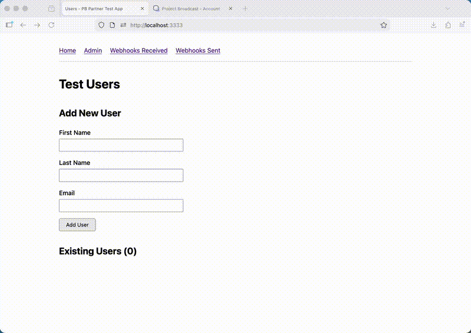

# Project Broadcast Partner Test App

A minimal local example and testing tool for Project Broadcast partner integrations.

## Demo



## Official Documentation

- **API Documentation**: https://app.projectbroadcast.com/apidoc/
- **Partner Integration Guide**: https://app.projectbroadcast.com/partner-integration.pdf

## What This Tests

1. **Partner Connect Flow** - OAuth-style user connection
2. **Integrator API** - Managing your integration settings
3. **Webhooks** - Receiving events from Project Broadcast (legacy and modern)
4. **User API** - Making API calls on behalf of connected users

## Requirements

- Node.js >= 24

## Quick Start

1. Copy `.env.example` to `.env` and fill in your credentials
2. `npm install`
3. `npm start`
4. Open http://localhost:3333

## Configuration

See `.env.example` for all available options:

```bash
PORT=3333

SESSION_SECRET=your-long-random-session-secret
PARTNER_ID=your-partner-id
SIGNING_KEY=your-signing-key
INTEGRATION_KEY=your-integration-key
BASE_CONNECT_URL=https://app.projectbroadcast.com/integrations/
BASE_API_URL=https://app.projectbroadcast.com/api/v1/
```

## Project Structure

```
├── api/              # API client modules for PB endpoints
│   ├── integrator.ts # Integrator API client
│   └── user.ts       # User API client
├── lib/              # Core utilities
│   ├── env.ts        # Environment configuration
│   └── crypto.ts     # Signing & signature verification
├── data/             # Local JSON storage for testing
│   ├── users.ts      # User storage module
│   └── webhook-events.ts
├── routes/           # Express route handlers
│   ├── home.ts       # Home page / user dashboard
│   ├── auth.ts       # Login, logout, OAuth callback
│   ├── admin.ts      # Admin dashboard & actions
│   ├── webhooks.ts   # Webhook receiver
│   └── legacy-hooks.ts
├── views/            # EJS templates
├── app.ts            # Express application
└── bin/www.ts        # HTTP server entry point
```

## Routes

### User Routes

- `GET /` - Home page / user list
- `POST /users` - Create a new test user
- `POST /users/:id/delete` - Delete a test user
- `GET /login/:userId` - Login as a user
- `GET /logout` - Logout
- `GET /connection` - OAuth callback

### Webhook Routes

- `POST /webhooks/events` - Webhook receiver (recommended)
- `POST /hooks/connected` - Legacy connected webhook
- `POST /hooks/disconnected` - Legacy disconnected webhook

### Admin Routes

- `GET /admin` - Admin dashboard
- `POST /admin/webhook` - Update webhook URL and event subscriptions
- `POST /admin/webhook-test` - Send test webhook
- `GET /admin/webhooks-received` - View webhooks we received
- `GET /admin/webhooks-sent` - View webhooks PB sent (from API)
- `POST /admin/webhooks/:id/replay` - Replay a failed webhook

## Webhook Event Types

- `user-connect` - User connected their account (includes apiKey in data)
- `user-disconnect` - User disconnected their account
- `trackable-link-click` - A trackable link was clicked
- `landing-page-view` - A landing page was viewed
- `test` - Test event (from webhook test button)

## Signature Verification

This app demonstrates two signature verification methods:

### 1. Legacy Signing (Connect Flow & Legacy Hooks)

- Timestamp in **milliseconds**
- Sort params by key, join values with `:`
- HMAC-SHA256 of the joined string
- Signature passed as query param or body field

### 2. Webhook Signing

- Timestamp in **seconds** (Unix time)
- Header format: `X-PB-Signature: t={timestamp},v1={signature}`
- Sign the string `{timestamp}.{rawBody}`

See [lib/crypto.ts](lib/crypto.ts) for implementation details.

## Development

```bash
# Run with auto-reload
npm start

# Type check
npm run typecheck

# Lint and format
npm run lint
npm run format
```
